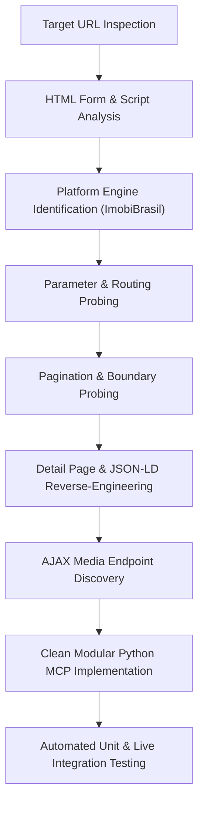

# Rental Search API Reverse-Engineering Research Plan & Report

## 1. Executive Summary

This document presents the reverse-engineering research plan, execution findings, architectural design, and verification results for the real estate agency portal **Nilton Corretor de Imóveis** (`niltoncorretordeimoveis.com.br`).

The research successfully identified all search endpoints, query parameters, pagination mechanics, filtering conventions, detail page structures, microdata schemas, and media delivery endpoints necessary to reproduce the rental listing and property retrieval flow.

---

## 2. Research Plan & Methodology

### 2.1 Research Objectives
1. **Endpoint Discovery**: Identify the exact HTTP endpoints responsible for search queries, filtering, pagination, property detail retrieval, and media retrieval.
2. **Parameter Encoding Analysis**: Reverse-engineer parameter conventions, including numeric constraints, range parameters, and room count formats.
3. **Pagination & Boundary Testing**: Determine page size limits, page indicator parameters, and boundary behavior when requesting out-of-bounds pages.
4. **Detail & Media Extraction**: Uncover structured microdata (`Schema.org` JSON-LD) and internal AJAX APIs for property details and photo galleries.
5. **Architectural Implementation**: Structure the extracted intelligence into reusable Python modules adhering strictly to SOLID, Clean Code, Object Calisthenics, and Design Patterns.

### 2.2 Investigation Methodology


---

## 3. Reverse-Engineering Findings & Discovery Log

### 3.1 Platform Engine Identification
- **Platform**: ImobiBrasil Real Estate SaaS platform.
- **Frontend Template**: Template `t27` / `t32` (`/t27/js/lista_imoveis.js`, `/t27/lista_imoveis_fotos.php`).
- **Server Encoding**: Server sends `text/html; charset=iso-8859-1` (Latin1) headers.
- **Client Scripting**: Inline JavaScript `dgCidadesBairros` containing complete city and neighborhood catalogs.

### 3.2 Target URL Reproduction Analysis
- **Target URL**: `https://niltoncorretordeimoveis.com.br/imovel/locacao/todos/timoteo`
- **Route Breakdown**:
  - Path: `/imovel/{finalidade}/{tipo}/{cidade}/?&{params}`
  - `finalidade`: `locacao` (Rentals)
  - `tipo`: `todos` (All categories)
  - `cidade`: `timoteo` (Timóteo municipality)
- **Results Behavior**:
  - Page 1 returns 15 genuine listings (`.imovelcard[data-link]`).
  - Page 2 returns remaining listings (7 listings, total 22).
  - Out-of-bounds page returns 0 genuine listings.

### 3.3 Discovered Parameter Encoding Matrix
During dynamic probing of the search engine, the following parameter semantics were discovered:
1. **ImobiBrasil Room Range Encoding**:
   - Exact count: `1`..`5`.
   - Minimum ("N or more"): Encoded as `20 + N` (`21` for 1+, `22` for 2+, `23` for 3+, `24` for 4+, `25` for 5+).
   - Applied uniformly to `dormitorios`, `suites`, `banheiros`, and `vagas`.
2. **Numeric Price & Area Constraints**:
   - `vmi`: Minimum price (Valor Mínimo in BRL).
   - `vma`: Maximum price (Valor Máximo in BRL).
   - `areaMinima`: Minimum area in m².
   - `areaMaxima`: Maximum area in m².
3. **Multi-Neighborhood Filtering**:
   - Parameter: `bairros={id1},{id2}` (e.g. `bairros=498991,498264`).
   - Evaluated as logical `OR` across selected neighborhoods.
4. **Pagination**:
   - Parameter: `pag={page_number}` (1-indexed).
   - Fixed page size: **15 listings per page**.
   - Dummy Pagination Wrapper: In template `t27`, pagination container `.lista_imoveis_paginacao` is enclosed in a `<div class="imovelcard" style="background-color:unset;">`. Genuine listing cards have `data-link` attribute.
5. **Sorting**:
   - `ord=menor_valor`: Ascending price.
   - `ord=maior_valor`: Descending price.
   - `ord=recentes`: Chronological descending.
6. **Reference Code Matching**:
   - `ref={code}` (e.g. `IM0670`).
   - `reftipo=exata`.

### 3.4 Discovered Endpoints
| Endpoint | Method | Response Type | Purpose |
| :--- | :--- | :--- | :--- |
| `/imovel/{finalidade}/{tipo}/{cidade}/` | `GET` | HTML (`iso-8859-1`) | Search listings with filters and pagination. |
| `/imovel/{property_id}` | `GET` | HTML (`iso-8859-1`) | Direct property detail page with JSON-LD microdata. |
| `/t27/lista_imoveis_fotos.php?imovel={id}` | `GET` | JSON | Property gallery image file names. |
| `/imagens/imoveis/{arquivo_imm}` | `GET` | Image (JPEG/PNG) | Full-resolution property photos. |

---

## 4. Software Architecture & Design Principles

The reverse-engineered capabilities have been organized into the `src/nilton_research` package, structured to serve as the module boundary for the central rental research MCP.

### 4.1 Prioritization Order
Architectural design adheres strictly to the specified priority order:
1. **Correctness First**: Real HTTP requests, complete parameter encoding, resilient parsing with JSON-LD and HTML fallbacks, error handling.
2. **Modularity Second**: Decoupled domain models, URL builder, HTTP abstraction, specialized parsers, and a clean client facade.
3. **Style Principles Third**:
   - **SOLID**: Single Responsibility, Open/Closed, Dependency Inversion.
   - **Object Calisthenics**:
     - Maximum 1 level of indentation per method.
     - Zero `else` keywords (guard clauses and early returns).
     - Primitives wrapped into meaningful domain value objects (`PriceRange`, `AreaRange`, `RoomCount`, `PageNumber`).
     - First-class collections (`ListingCollection`, `PhotoGallery`, `LocationCatalog`).
     - Maximum 2 instance variables per class (composed via collaborator bundles).
     - Functions $\le 15$ lines, classes $\le 100$ lines, modules $< 200$ lines.

### 4.2 Module Structure
```
src/nilton_research/
├── __init__.py                # Package exports
├── client.py                  # NiltonRentalClient (central MCP interface)
├── collaborators.py           # RentalNetworkGateway, RentalParserSuite
├── domain/
│   ├── __init__.py
│   ├── criteria.py            # SearchCriteria and parameter bundles
│   ├── enums.py               # TransactionType, PropertyType, SortOrder
│   ├── listing.py             # ListingSummary, ListingCollection
│   ├── metadata.py            # City, Neighborhood, LocationCatalog
│   ├── property.py            # PropertyDetail, PhotoGallery
│   └── values.py              # PriceRange, RoomCount, PageNumber, AreaRange
├── infrastructure/
│   ├── http_client.py         # HttpClientProtocol, HttpxHttpClient
│   └── url_builder.py         # Canonical route and query constructor
└── parsers/
    ├── __init__.py
    ├── detail_parser.py       # JSON-LD + HTML property detail parser
    ├── feature_extractor.py   # Card spec extractor
    ├── metadata_parser.py     # City/neighborhood catalog parser
    ├── photo_parser.py        # AJAX JSON photo gallery parser
    └── search_parser.py       # Search listing card parser
```

In addition, `scripts/` provides adapter modules (`RentalProviderProtocol`, `NiltonRentalProvider`) conforming to the cross-portal rental research interface.

---

## 5. Verification & Test Execution Results

The implementation was validated using both unit tests with stubbed HTTP responses and live integration tests against `niltoncorretordeimoveis.com.br`.

### 5.1 Verification Script Execution Summary
The automated runner `scripts/verify_research.py` verified:
1. Target search (`/imovel/locacao/todos/timoteo`): Returned 15 listings on page 1.
2. Filtered search: Correctly returned 3 listings matching criteria (max R$ 2.000 / 2+ dorms).
3. Property detail retrieval: Successfully parsed apartment 3561797, extracting reference (`IM0670`), price (`R$ 1.500,00`), location (`Eldorado, Timóteo - MG`), and specs (`3 dorms, 1 suíte, 1 banheiro`).
4. Photo gallery AJAX endpoint: Successfully extracted 4 high-resolution photo URLs from `/t27/lista_imoveis_fotos.php`.
5. Location catalog: Discovered 10 municipalities and 42 neighborhoods for Timóteo.
6. MCP Provider Protocol compliance: Verified `NiltonRentalProvider` implements `RentalProviderProtocol`.
